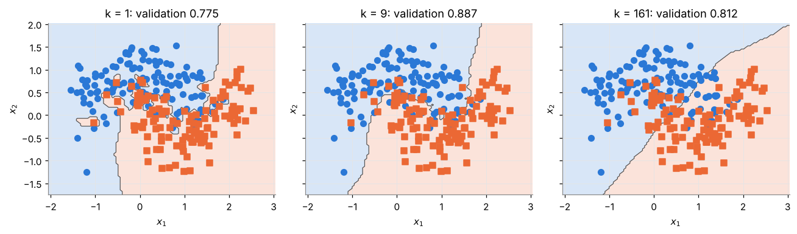

# ia-notebooks

Notebook e progetti di intelligenza artificiale e machine learning, dal didattico al reale: algoritmi implementati da zero in NumPy, pipeline con scikit-learn, dati da database SQL, API e LLM, fino a progetti completi testati.

Sono Lorenzo Casarosa, docente di informatica in un istituto tecnico, laurea magistrale in Data Science and Business Informatics all'Università di Pisa, co-autore di due manuali per la seconda prova dell'Esame di Stato (Informatica e Sistemi e Reti). Questo repository è il mio percorso, in cinque livelli, per passare dal capire gli algoritmi al metterli in produzione: più notebook per ogni livello, uno per ogni voce della [roadmap](ROADMAP.md), e ogni affermazione numerica viene da un'esecuzione reale del codice.

A chi serve: a chi vuole capire come funziona un algoritmo prima di chiamare una libreria, e ai docenti che cercano materiale pronto da riusare in classe (la licenza lo permette, citando la fonte). I notebook sono in inglese, per raggiungere più lettori; i README sono in italiano.

*Dal notebook 01: le regioni di decisione di un k-Nearest Neighbors scritto da zero, al variare di k. Con k = 1 ogni punto isolato si ritaglia la propria isola; con k troppo grande il confine diventa quasi una retta.*

## Come è organizzato

Ogni lavoro sta in una cartella numerata (`NN-titolo/`) con un proprio README: obiettivo, livello, fonti, istruzioni per eseguirlo. I notebook sono pubblicati nella versione completa, con output dell'esecuzione, e si aprono direttamente su Google Colab.

Ogni lavoro è collocato su uno dei cinque livelli del percorso, descritti in [ROADMAP.md](ROADMAP.md):

| Livello | Nome | Cosa significa |
|---|---|---|
| 1 | Da zero | L'algoritmo implementato a mano con liste o NumPy, per capirne il meccanismo |
| 2 | Librerie | Lo stesso problema con scikit-learn, pipeline e validazione corretta |
| 3 | Dati da database | Dati in SQLite/PostgreSQL, query SQL scritte a mano, risultati riscritti nel database |
| 4 | API e LLM | Modelli serviti con FastAPI, API REST, LLM con output strutturato e tool calling |
| 5 | Progetto completo | Database, modello, API e test automatici in un unico progetto eseguibile |

## Indice

| N. | Titolo | Livello | Stato | Link |
|---|---|---|---|---|
| 01 | k-Nearest Neighbors da zero con NumPy (in inglese) | 1 | Pubblicato | [01-knn-from-scratch-numpy](01-knn-from-scratch-numpy/) |

## Principi

- Ogni affermazione numerica viene da un'esecuzione reale del codice.
- Metodologia: suddivisione dei dati prima dell'analisi esplorativa, nessun leakage, split temporale quando esiste un asse temporale, seed fissati.
- Le fonti (Géron, *Hands-On Machine Learning*; mlfromscratch; Andrew Ng; documentazione ufficiale delle librerie) sono citate sezione per sezione.
- Nessuna chiave API nel repository: le variabili necessarie sono elencate nei file `.env.example`.

## Come eseguire

I notebook dei livelli 1 e 2 si aprono direttamente su Google Colab (badge nel README di ogni cartella). Per i livelli 3-5, ogni cartella contiene `requirements.txt` e le istruzioni di avvio.

## Licenza

Il codice è rilasciato con licenza [MIT](LICENSE); testi e figure con licenza [CC BY 4.0](LICENSE-CC-BY). In entrambi i casi il riuso è libero, anche in classe, a condizione di citare l'autore.
